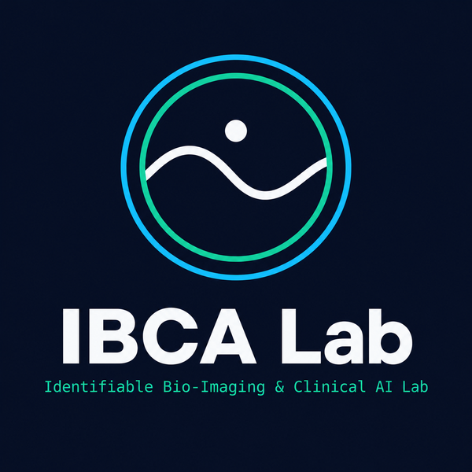

# IBCA Lab
### Identifiable Bio-Imaging & Clinical AI Lab

**From Mathematical Foundations to Open-Source Clinical & Biological Intelligence.**

<p align="center">
  
</p>

<p align="center">
  <strong>A Translational Research Wing of CodeEX</strong>
</p>

<p align="center">
  <a href="https://codeex.space/">CodeEX</a> ·
  <a href="https://github.com/sssihlcodeex/ibca-lab">GitHub Repository</a> ·
  <a href="https://ibca.codeex.space/">Lab Website</a>
</p>

---

## 01. The Lab

**IBCA Lab (Identifiable Bio-Imaging & Clinical AI Lab)** is a translational research initiative focused on the intersection of applied mathematics, biological imaging, identifiable representation learning, clinical artificial intelligence, and scientific software engineering.

We aim to investigate how mathematical structure, computational modelling, and carefully engineered machine-learning systems can address meaningful problems in biological and clinical environments.

Our approach extends beyond model development. We emphasise the complete research lifecycle:

- Mathematical formulation of scientific problems.
- Design of identifiable and interpretable computational representations.
- Leakage-resistant experimental validation.
- Reproducible scientific benchmarking.
- Open-source implementation and documentation.
- Translation of research methods into accessible computational tools.

We believe that scientific intelligence should not remain confined to experimental notebooks or isolated research environments. It should be reproducible, inspectable, accessible, and useful.

**Our direction is simple: rigorous mathematics, reliable intelligence, and research that can be independently reproduced.**

---

## 02. Vision & Mission

### Vision

To develop a research ecosystem where mathematical foundations and computational intelligence contribute to more reliable biological understanding and accessible clinical technologies.

### Mission

IBCA Lab seeks to:

1. Advance identifiable representation learning for biological and cellular imaging.
2. Investigate computational methods for practical clinical screening and diagnostic support.
3. Develop quantitative imaging methods grounded in mathematical and physical principles.
4. Establish rigorous benchmarking protocols that minimise data leakage and misleading evaluation.
5. Release reusable, documented, and accessible scientific software.
6. Translate validated research outcomes into practical tools that can operate under resource constraints.

### Research Philosophy

We follow five guiding principles:

| Principle | Research commitment |
|---|---|
| Mathematical rigour | Formulate problems before selecting architectures. |
| Identifiability | Seek representations with meaningful and distinguishable factors. |
| Experimental integrity | Prevent leakage and evaluate generalisation honestly. |
| Reproducibility | Make methods, configurations and evaluation procedures inspectable. |
| Open science | Share reusable software and research outputs responsibly. |

---

## 03. Research Directions

IBCA Lab operates through three interconnected research tracks.

### Track 01 — Cellular & Drug-Discovery Microscopy

**Focus: Cell Painting / JUMP-CP**

High-content cellular imaging provides a computational window into biological responses to chemical perturbations. However, measured image variations can reflect both genuine biological effects and unwanted technical variation.

A central challenge is distinguishing biological signals, including toxicity-related changes and Mechanism of Action (MoA), from batch effects, staining variation, and imaging artifacts.

**Research objectives**

- Investigate identifiable representation learning for cellular phenotypes.
- Separate biologically meaningful variation from technical confounders.
- Study batch robustness and cross-experimental generalisation.
- Develop representations suitable for downstream biological analysis.
- Establish reproducible evaluation protocols for cellular imaging.

**Planned methods**

- Representation learning.
- Disentangled and identifiable modelling.
- Contrastive and self-supervised learning.
- Batch-aware experimental evaluation.
- Statistical and biological interpretability analysis.

**Intended deliverables**

- `ibca_core`: An open-source PyTorch research library.
- Batch-robust evaluation benchmarks.
- Reproducible experimental pipelines.
- Peer-reviewed research manuscripts.

---

### Track 02 — Real-Time Clinical Screening & Diagnostic Services

**Focus: Accessible and efficient clinical AI**

Advanced AI systems are not useful in practical environments if they require expensive infrastructure, inaccessible deployment arrangements, or computational resources unavailable to their intended users.

This track investigates lightweight and uncertainty-aware AI systems designed for practical clinical environments.

**Research objectives**

- Investigate efficient computer-vision models for screening tasks.
- Explore clinical Natural Language Processing (NLP).
- Study uncertainty estimation and calibration.
- Develop models suitable for resource-constrained hardware.
- Investigate local-first and self-hosted deployment architectures.

**Planned methods**

- Lightweight vision architectures.
- Model quantisation and ONNX deployment.
- Uncertainty calibration.
- Clinical text processing.
- Efficient inference pipelines.
- Privacy-conscious system architecture.

**Intended deliverables**

- Self-hosted research web applications and APIs.
- Quantised ONNX model artefacts.
- Calibrated decision-support pipelines.
- Reproducible deployment configurations.

Clinical applications will remain research and decision-support systems unless and until appropriate independent validation and applicable regulatory requirements are satisfied.

---

### Track 03 — Quantitative Bio-Imaging & Dynamical Systems

**Focus: Mathematical modelling of biological measurements**

Biological imaging frequently involves incomplete, noisy, and physically constrained measurements. Extracting meaningful information requires more than applying conventional image-processing operations.

This track explores mathematical and computational approaches to reconstructing, analysing, and modelling biological measurements.

**Research objectives**

- Investigate physics-informed imaging reconstruction.
- Model biological processes using differential equations.
- Study numerical stability and uncertainty.
- Develop quantitative representations of biological measurements.
- Explore the connection between mathematical models and imaging systems.

**Planned methods**

- Differential equation modelling.
- Numerical methods.
- Physics-informed learning.
- Inverse problems.
- Image reconstruction.
- Dynamical systems analysis.

**Intended deliverables**

- Reproducible quantitative imaging toolkits.
- Open simulation benchmarks.
- Mathematical modelling implementations.
- Research publications.

---

## 04. How We Conduct Research

Research at IBCA Lab follows a structured development and validation pipeline.

```text
┌─────────────────────────────────────────────┐
│       01. MATHEMATICAL FORMULATION          │
│                                             │
│  Problem definition · Assumptions           │
│  Mathematical modelling · Algorithm design │
└──────────────────────┬──────────────────────┘
                       │
                       ▼
┌─────────────────────────────────────────────┐
│       02. VALIDATION & BENCHMARKING         │
│                                             │
│  Plate-held-out evaluation                  │
│  Scaffold-held-out evaluation               │
│  Uncertainty-calibration stress tests       │
└──────────────────────┬──────────────────────┘
                       │
                       ▼
┌─────────────────────────────────────────────┐
│       03. OPEN-SOURCE RESEARCH              │
│                                             │
│  Reproducible implementations               │
│  Documentation · Software releases          │
│  Peer-reviewed research                     │
└──────────────────────┬──────────────────────┘
                       │
                       ▼
┌─────────────────────────────────────────────┐
│       04. TRANSLATIONAL DEVELOPMENT         │
│                                             │
│  Lightweight inference                      │
│  Local deployment · Research services       │
│  Practical laboratory and clinical tools    │
└─────────────────────────────────────────────┘
```

Every stage is intended to produce independently inspectable research artefacts.

We distinguish between experimental performance on a particular dataset and evidence of generalisation to genuinely independent data.

---

## 05. Open-Source Ecosystem

Open-source development is a central component of IBCA Lab.

Our software direction focuses on reusable research infrastructure rather than isolated implementations.

| Project | Description | Current status |
|---|---|---|
| `ibca_core` | Core PyTorch research library | Foundation under development |
| Benchmark Suite | Reproducible evaluation protocols | Research planning |
| Edge Inference Tools | Lightweight deployment utilities | Architecture planning |

### ibca_core

`ibca_core` is intended to become the central computational foundation for IBCA Lab's research activities.

Its proposed components include:

- **Models:** Reusable model architectures.
- **Representations:** Identifiable representation-learning methods.
- **Evaluation:** Experimental validation and benchmarking utilities.
- **Imaging:** Quantitative image-processing and reconstruction utilities.
- **Utilities:** Configuration, reproducibility, and experiment-management components.

The package is being developed incrementally. Its initial repository structure should not be interpreted as a claim that all research methods have already been implemented.

### Development philosophy

All software contributions should prioritise:

- Clear interfaces.
- Type annotations.
- Documentation.
- Unit testing.
- Reproducible configurations.
- Dependency management.
- Appropriate licensing.
- Computational efficiency.

---

## 06. Scientific Integrity & Reproducibility

A research result is only as meaningful as the experimental procedure supporting it.

IBCA Lab places particular emphasis on experimental integrity.

### Data leakage prevention

Our intended evaluation philosophy includes:

- Plate-held-out evaluation for cellular imaging.
- Scaffold-held-out evaluation for molecular generalisation.
- Independent training, validation, and test partitions.
- Explicit documentation of preprocessing and split construction.
- Avoidance of information leakage through duplicated or related samples.

### Uncertainty and calibration

Predictive confidence should not automatically be interpreted as predictive reliability.

We intend to investigate:

- Calibration analysis.
- Confidence reliability.
- Uncertainty estimation.
- Distribution-shift sensitivity.
- Stress testing under changed experimental conditions.

### Reproducible experimentation

Research implementations should document:

- Dataset provenance.
- Data preprocessing.
- Model configurations.
- Random seeds.
- Software dependencies.
- Training procedures.
- Evaluation metrics.
- Experimental limitations.

Results should be accompanied by enough methodological information to allow independent inspection and, where possible, reproduction.

See [`docs/METHODOLOGY.md`](docs/METHODOLOGY.md) and [`docs/REPRODUCIBILITY.md`](docs/REPRODUCIBILITY.md).

---

## 07. Research Team

### Principal Investigator

**Sai Pradyumna Thiriveedi**

Principal Investigator, IBCA Lab  
President, CodeEX

Aspiring Medical AI Engineer & Data Scientist.

Research interests include applied mathematics, machine learning, biological imaging, clinical AI, and scientific software engineering.

**Professional profiles**

- [GitHub](https://github.com/TSaiPradyumna/)
- [LinkedIn](https://www.linkedin.com/in/sai-pradyumna-thiriveedi-96441b278/)
- [Google Scholar](https://scholar.google.com/citations?user=xCYD0lUAAAAJ&hl=en)
- [Medium](https://medium.com/@tsaipradyumna)
- [Linktree](https://linktr.ee/saipradyumnathiriveedi)
- [Resume](https://drive.google.com/file/d/1dDqmDtRhlbgeE9o-pG5Btw35jh7cPzVu/view?usp=sharing)

### Research Team

The current research team includes:

1. Lohith Reddy Chinthamreddy
2. Sachin Yagnesh K
3. Puneeth Kumar B
4. Ediga Sai Charan
5. Ambati Haridhar

Team responsibilities, research assignments, and individual portfolios will be documented as they are formally established.

### Research Pods

Research activities are organised into three focused pods.

| Pod | Research area |
|---|---|
| Pod 01 | Cell Painting & Identifiable Representation Learning |
| Pod 02 | Real-Time Clinical Screening & Edge Services |
| Pod 03 | Quantitative Bio-Imaging & Dynamical Systems |

Each pod is designed around three functional responsibilities:

- Pod Lead.
- Modeling Lead.
- Systems Lead.

Individual assignments are announced as pod structures are established.

---

## 08. Roadmap

IBCA Lab is being established as a long-term research initiative.

The following roadmap represents planned development rather than completed milestones.

| Phase | Focus | Objectives |
|---|---|---|
| I | Research Foundation | Repository, documentation, literature review and problem formulation |
| II | Experimental Foundations | Dataset analysis, evaluation protocols and baseline development |
| III | Method Development | Initial modelling and computational implementations |
| IV | Validation | Robustness testing, calibration and independent evaluation |
| V | Open Research | Software releases, technical reports and manuscript preparation |
| VI | Translation | Lightweight tools, self-hosted services and deployment research |

Progress will be reflected through repository releases, documented experiments, issues, and research publications.

---

## 09. Repository Structure

The repository is intended to maintain a clear separation between research documentation, scientific implementations, experiments, and the public-facing website.

```text
ibca-lab/
│
├── index.html
├── README.md
├── LICENSE
├── CITATION.cff
├── CONTRIBUTING.md
├── CODE_OF_CONDUCT.md
├── SECURITY.md
├── .gitignore
├── .editorconfig
├── pyproject.toml
│
├── assets/
│   ├── logo/
│   ├── images/
│   └── team/
│
├── docs/
│   ├── RESEARCH_OVERVIEW.md
│   ├── RESEARCH_TRACKS.md
│   ├── METHODOLOGY.md
│   ├── ROADMAP.md
│   ├── TEAM_AND_PODS.md
│   ├── REPRODUCIBILITY.md
│   ├── DATA_GOVERNANCE.md
│   ├── CLINICAL_SAFETY.md
│   └── PUBLICATIONS.md
│
├── research/
│   ├── cellular-microscopy/
│   ├── clinical-ai/
│   └── quantitative-bioimaging/
│
├── ibca_core/
│   └── src/
│       └── ibca_core/
│           ├── models/
│           ├── representations/
│           ├── evaluation/
│           ├── imaging/
│           └── utils/
│
├── tests/
├── examples/
│
└── .github/
    ├── ISSUE_TEMPLATE/
    ├── workflows/
    └── PULL_REQUEST_TEMPLATE.md
```

---

## 10. Getting Started

### Clone the repository

```bash
git clone https://github.com/sssihlcodeex/ibca-lab.git

cd ibca-lab
```

### Explore the website

Open `index.html` directly in a browser.

No build process or JavaScript framework is required.

### Set up the Python development environment

The Python package is maintained separately from the static website.

```bash
python -m venv .venv
```

Activate the environment:

**Windows**

```bash
.venv\Scripts\activate
```

**Linux / macOS**

```bash
source .venv/bin/activate
```

Install the package in editable mode once its initial package configuration is available:

```bash
pip install -e .
```

Run tests:

```bash
pytest
```

---

## 11. Collaboration & Contributions

IBCA Lab welcomes individuals interested in contributing to mathematical research, biological imaging, machine learning, clinical AI, and scientific software development.

### Areas of contribution

- Mathematical modelling.
- Python and PyTorch development.
- Computer vision.
- Representation learning.
- Biological image analysis.
- Clinical NLP.
- Numerical computing.
- Model evaluation and benchmarking.
- Scientific documentation.
- Research software engineering.

### Expected foundation

Collaborators should demonstrate:

- Mathematical familiarity with Linear Algebra, Probability, and Calculus.
- Practical Python programming experience.
- Familiarity with PyTorch or willingness to develop it.
- Commitment to approximately 6–8 hours of weekly research activity.
- An interest in open science and reproducible research.

### Selection process

The proposed selection process includes a 48-hour technical trial.

The trial is intended to assess:

1. Understanding of the assigned research problem.
2. Mathematical and computational reasoning.
3. Implementation quality.
4. Documentation and reproducibility.
5. Ability to communicate technical decisions.

The trial is an evaluation exercise, not a guarantee of selection or publication.

For contribution guidelines, see [`CONTRIBUTING.md`](CONTRIBUTING.md).

---

## 12. Data Governance & Responsible Research

Research involving biological and clinical data requires careful treatment of privacy, permissions, and potential harm.

IBCA Lab is committed to responsible research practices.

We expect all contributors to:

- Use datasets only under appropriate permissions and licensing.
- Avoid committing identifiable patient information.
- Follow applicable privacy and data-protection requirements.
- Document dataset sources and restrictions.
- Apply appropriate access controls to sensitive information.
- Avoid presenting experimental models as clinically validated diagnostic systems.
- Communicate model limitations and uncertainty clearly.

**Never upload patient records, identifiable medical images, credentials, or confidential datasets to this public repository.**

See [`docs/DATA_GOVERNANCE.md`](docs/DATA_GOVERNANCE.md) and [`docs/CLINICAL_SAFETY.md`](docs/CLINICAL_SAFETY.md).

---

## 13. Publications & Research Outputs

IBCA Lab is currently establishing its research foundations.

**Inaugural manuscripts are in preparation.**

There are no publications listed at this stage.

Future research outputs will be documented with appropriate bibliographic information, author attribution, abstracts, publication status, and associated software or data links where available.

We will not list unverified manuscripts, fabricated DOI references, or unpublished results as completed publications.

---

## 14. Licensing

The repository is intended to use the MIT License for its original root-level software and website components.

The `ibca_core` package is also intended to use MIT licensing.

Third-party dependencies, datasets, model weights, and external research assets may carry separate licensing and usage restrictions. Their respective licences must be respected.

See [`LICENSE`](LICENSE) for the applicable repository licence.

---

## 15. Contact

For research collaboration, technical discussions, and general enquiries:

**IBCA Lab**

Email: saipradyumnat@codeex.space

**Connect**

- [GitHub Repository](https://github.com/sssihlcodeex/ibca-lab)
- [CodeEX](https://codeex.space/)
- [Principal Investigator — LinkedIn](https://www.linkedin.com/in/sai-pradyumna-thiriveedi-96441b278/)
- [Principal Investigator — Google Scholar](https://scholar.google.com/citations?user=xCYD0lUAAAAJ&hl=en)

---

<p align="center">
  <strong>IBCA LAB</strong><br>
  Identifiable Bio-Imaging & Clinical AI Lab
  <br><br>
  <em>Mathematical Foundations. Identifiable Intelligence. Reproducible Research.</em>
  <br><br>
  A Translational Research Wing of CodeEX.
</p>
